# 🥤 Novatech Autonomous Protein Vending Machine

**Touchscreen kiosk software for a self-service protein shake vending machine.** Customers pick a supplement, choose a dose and number of glasses, build an order, pay by UPI, and the machine dispenses.

Built with **React 18 + Vite**, and designed to run full-screen in **Chrome kiosk mode** on the machine's display.

> Developed by **Novatech Robo Pvt Ltd**

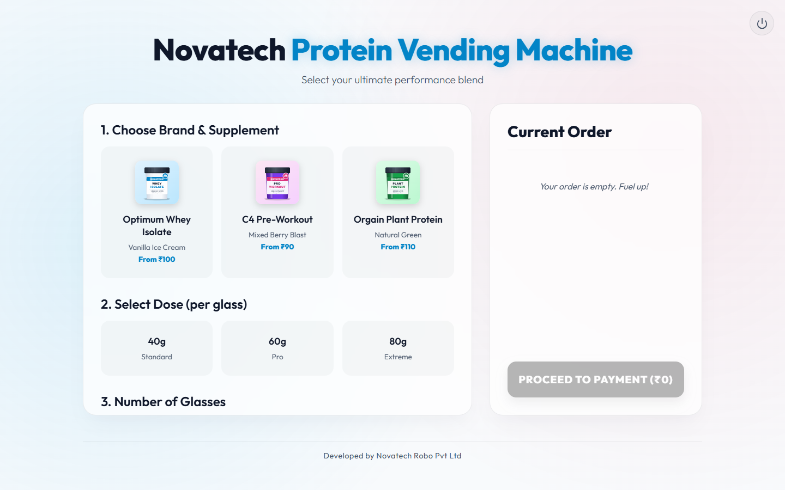

---

## ✨ Features

| Feature | Description |
|---|---|
| 🧴 **Product selection** | Three supplements, each with a product image, flavour and starting price |
| ⚖️ **Dose selection** | 40 g *Standard*, 60 g *Pro* or 80 g *Extreme*. The price for each dose updates live for the chosen product |
| 🔢 **Glass counter** | Order 1–5 glasses of the same shake at once |
| 🛒 **Multi-item order** | Add several different shakes to one order, remove any of them, and see the running total |
| 💳 **Payment screen** | UPI / QR is enabled. Card and NFC are shown but disabled ("Not Available") |
| ⏳ **Payment → dispensing flow** | Waiting-for-payment spinner, then a *Dispensing…* screen, then the order resets for the next customer |
| ⏻ **Kiosk exit button** | Hidden-looking power button (top right) that closes the kiosk window, for staff |
| 📱 **Responsive** | Two-panel layout on the kiosk screen, stacked single column on narrow screens |
| 💰 **Easy pricing config** | All prices sit in one object at the top of `src/App.jsx` |

---

## 📸 Screenshots: full customer journey

### 1. Home screen
The customer sees the three products, their starting prices and an empty order.


### 2. Choose a product
Tapping a product highlights it with a blue glow.

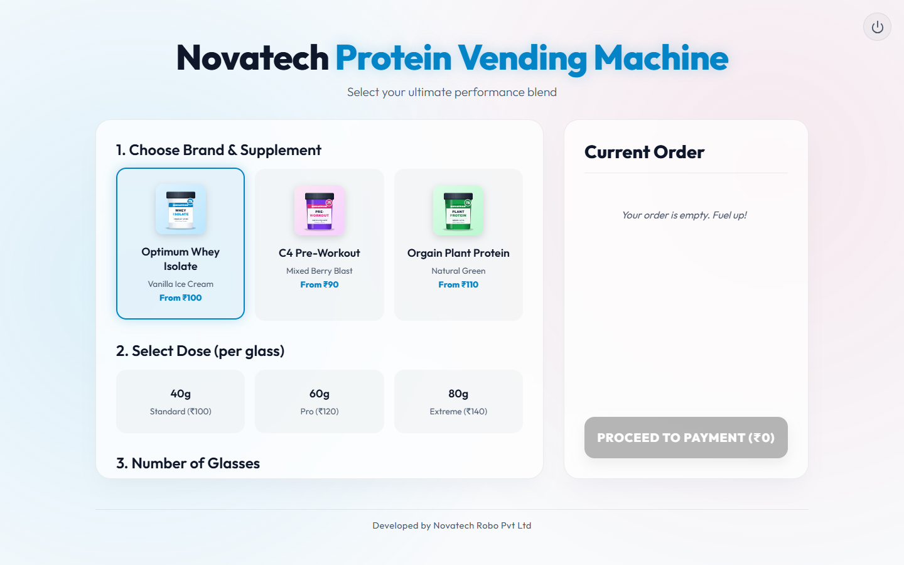

### 3. Choose dose and number of glasses (panel scrolled down)
Once a product is selected, each dose shows its real price (here Whey Isolate: ₹100 / ₹120 / ₹140). The **−/+** counter sets the number of glasses, and **Add to Order** turns blue when the selection is complete. The left panel scrolls on its own while the order panel stays in place.

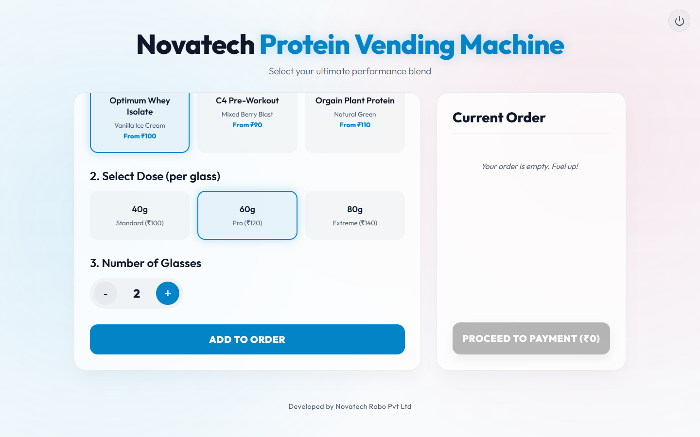

### 4. Build an order with several items
Different shakes can be added to one order. Each line shows quantity, flavour, dose and price per glass, and the checkout button shows the running total.
*Example: 2 × Whey 60 g (₹240) + 1 × C4 80 g (₹120) + 1 × Plant 40 g (₹110) = **₹470***

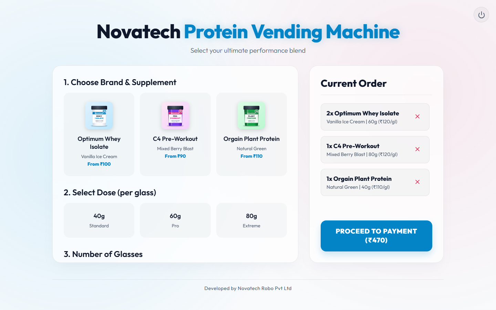

### 5. Remove an item
The red ✕ removes a line and the total updates immediately (₹470 → ₹360).

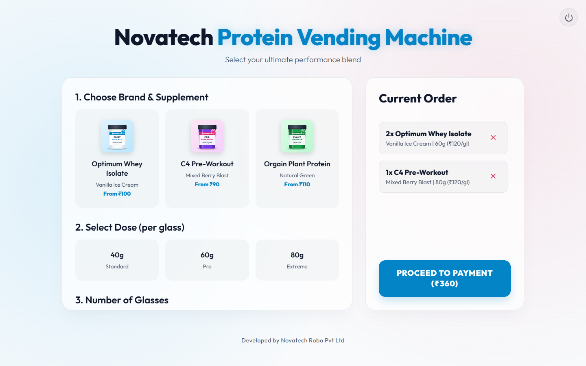

### 6. Select payment method
UPI / QR is available. Card and NFC appear but are disabled for now.

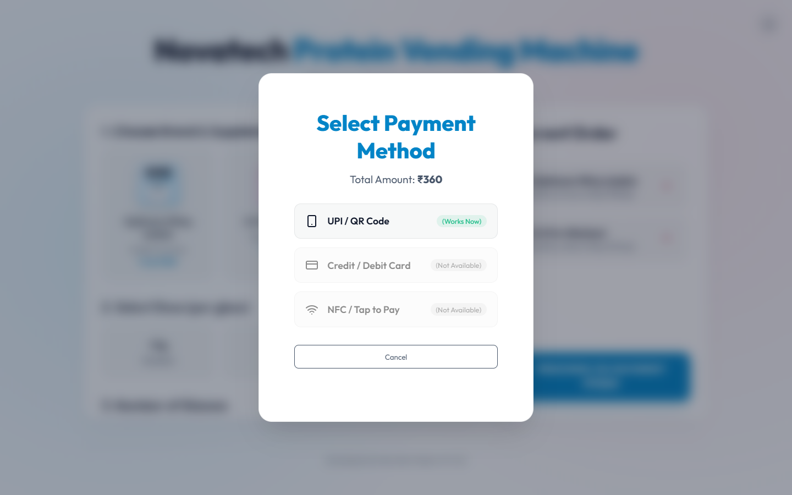

### 7. Waiting for UPI payment
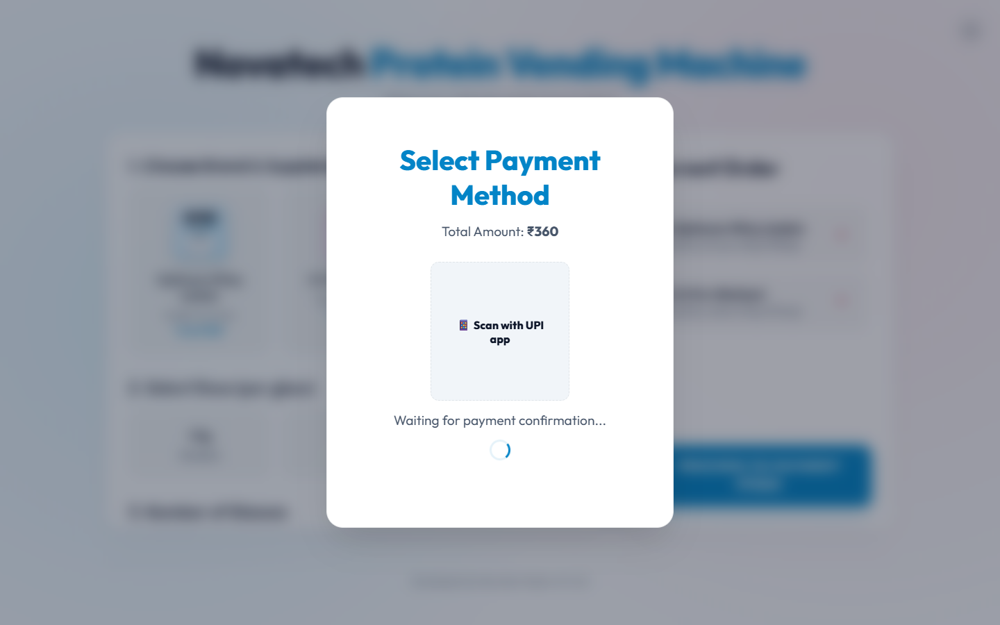

### 8. Dispensing
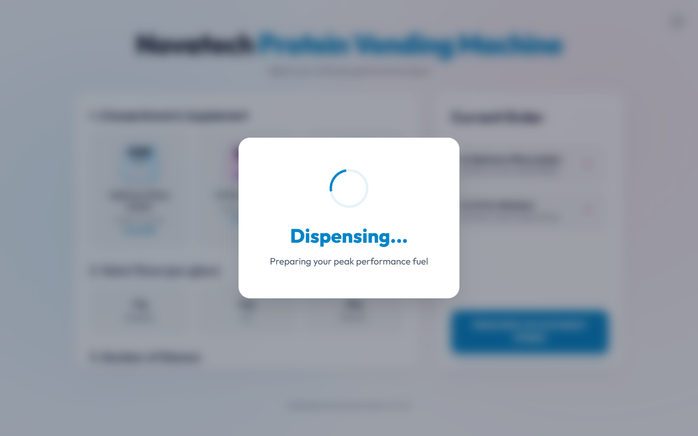

### 9. Order complete, ready for the next customer
After dispensing, a confirmation alert appears and the order is cleared automatically.

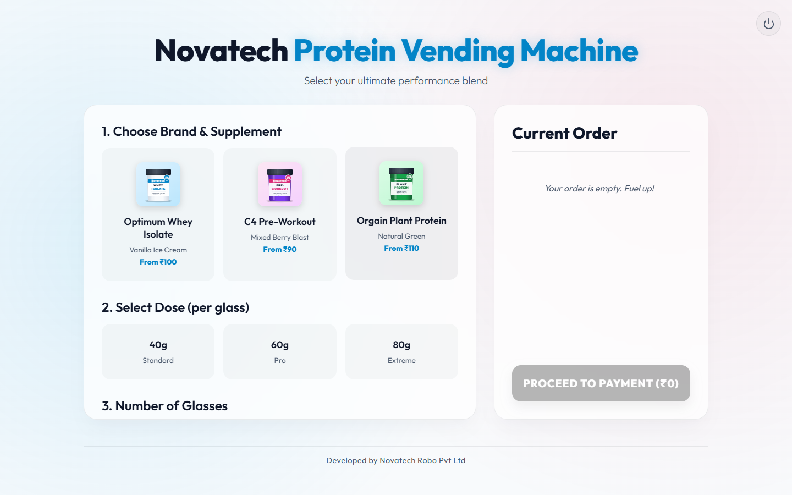

### 10. Mobile / narrow-screen layout (full page)
On narrow screens the panels stack and the page scrolls.

<p align="center">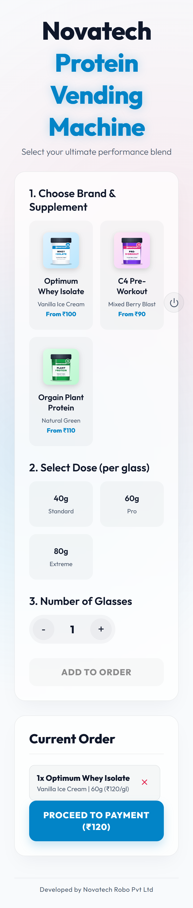</p>

---

## 🔄 How it works

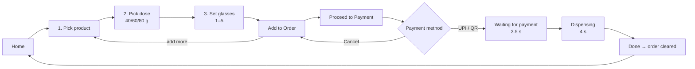

All screens live in one React component (`src/App.jsx`) and switch on state:

| State | Purpose |
|---|---|
| `selectedFlavor`, `selectedDose`, `glasses` | The shake currently being configured |
| `cart` | List of `{ id, flavor, dose, glasses }` items in the order |
| `showPayment`, `paymentMethod` | Payment screen visibility and chosen method |
| `isDispensing` | Shows the dispensing screen |

**Price of a line** = `getItemPrice(product, dose) × glasses`. The **order total** is the sum of all lines.

---

## 💰 Pricing

Prices are in INR per glass and set in `SHAKE_PRICES` in [`src/App.jsx`](src/App.jsx):

| Product | Flavour | 40 g (Standard) | 60 g (Pro) | 80 g (Extreme) |
|---|---|:---:|:---:|:---:|
| Optimum Whey Isolate | Vanilla Ice Cream | ₹100 | ₹120 | ₹140 |
| C4 Pre-Workout | Mixed Berry Blast | ₹90 | ₹105 | ₹120 |
| Orgain Plant Protein | Natural Green | ₹110 | ₹135 | ₹160 |

To change a price, edit the `base`, `add60g` and `add80g` values:

```js
const SHAKE_PRICES = {
  'whey-iso': { base: 100, add60g: 20, add80g: 40 },   // 40g = 100, 60g = 120, 80g = 140
  ...
};
```

To **add a product**, add an entry to `FLAVORS` (with an image in `public/images/`) and a matching entry in `SHAKE_PRICES`.

---

## 🚀 Getting started

### Requirements
- [Node.js](https://nodejs.org/) 18 or newer
- Google Chrome (for kiosk mode)

### One-click kiosk launch (Windows)
Double-click **`Run_UI.bat`**. It will:
1. Run `npm install`
2. Start the Vite dev server on **http://localhost:5173**
3. Open Chrome in **full-screen kiosk mode** (`--kiosk`) with its own browser profile

### Manual
```bash
npm install
npm run dev        # http://localhost:5173
npm run build      # production build → dist/
npm run preview    # serve the production build
```

### Leaving kiosk mode
Tap the **⏻ button** (top-right). The browser calls `/api/minimize`; the Vite server then runs a small hidden VBScript that presses **Alt + F4**, which closes the kiosk window.

---

## 📁 Project structure

```
.
├── index.html               # Entry HTML (Outfit font, favicon, #root)
├── Run_UI.bat               # Windows one-click: install, start server, open Chrome kiosk
├── vite.config.js           # Vite + React + custom /api/minimize endpoint (kiosk exit)
├── package.json
├── public/
│   ├── favicon.svg
│   └── images/              # Product images (whey-isolate, pre-workout, plant-protein)
├── src/
│   ├── main.jsx             # Mounts <App />
│   ├── App.jsx              # Whole kiosk UI: products, pricing, cart, payment, dispensing
│   └── index.css            # Light glass-style theme, animations, responsive layout
├── docs/screenshots/        # Images used in this README
├── script.js                # ⚠️ Legacy vanilla-JS version (not used)
└── style.css                # ⚠️ Legacy dark theme for script.js (not used)
```

---

## 🛠️ Tech stack
**React 18** · **Vite 4** · **lucide-react** icons · Google Font **Outfit** · Chrome kiosk mode · Windows Script Host (kiosk exit)

---

## ⚠️ Notes and known limitations

- **Payment and dispensing are simulated.** The UPI screen shows a placeholder instead of a real QR code. Payment "succeeds" after 3.5 s and dispensing finishes after 4 s (`setTimeout`). The next step is connecting a real UPI gateway (Razorpay, PhonePe, Paytm) and the machine's dispensing controller, such as an ESP32 or Arduino over serial, Wi-Fi or MQTT.
- **The kiosk exit only works with the dev server** (`npm run dev`). `/api/minimize` is a Vite dev-server plugin, so it doesn't exist in `npm run build` / static hosting. It also sends Alt + F4 to **whichever window is active**, so use it only on the kiosk machine.
- **The confirmation uses `alert()`**, which pauses the kiosk until someone taps OK. A self-closing success screen would suit an unattended machine better.
- **Product images are illustrations.** The images in `public/images/` are generic placeholder tubs. Replace them with real product photos (PNG/JPG/SVG) using the same file names, or update the paths in `FLAVORS`.
- **`script.js` and `style.css` are an older plain-JavaScript prototype** (6 flavours, $ pricing, dark theme). `index.html` doesn't load them; they can be deleted.

---

## 👤 Author
Developed by **Archit Yadav** · [@ArchitYadav07](https://github.com/ArchitYadav07) for **Novatech Robo Pvt Ltd**
